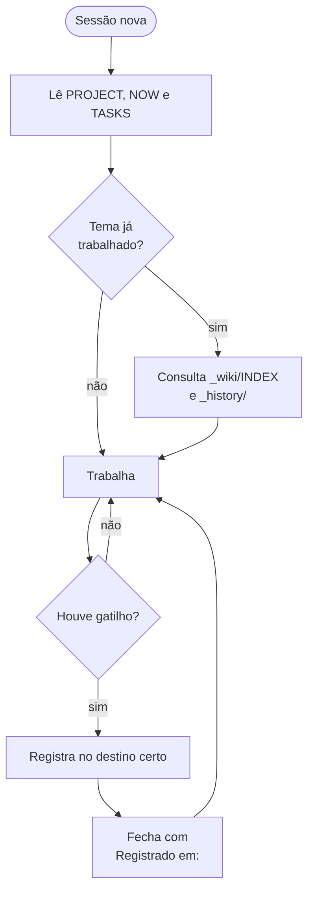
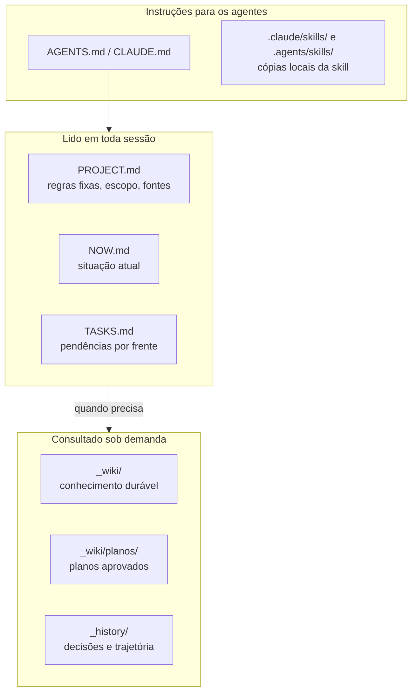

# Project Memory

  

Memória operacional para projetos longos conduzidos por pessoas e agentes de IA. O projeto guarda, em arquivos Markdown, o
estado atual, as pendências, as decisões e o conhecimento acumulado, de forma que qualquer sessão nova (de qualquer agente)
retome o trabalho lendo três arquivos, sem varrer a pasta inteira e sem depender da memória de uma conversa.

O problema que ele resolve: em projeto de semanas, cada sessão nova começa do zero, repete propostas já descartadas e perde as
decisões tomadas em conversas anteriores. Aqui a memória mora no repositório, e o agente registra o que aconteceu ao fim de cada
passo, sem esperar que a pessoa peça.

## Como funciona

Cada sessão segue o mesmo ciclo: lê o mínimo, consulta o histórico só quando o tema já foi trabalhado e, ao fim de cada passo
relevante, grava cada coisa no seu lugar.



Gatilho é qualquer um destes: decisão da pessoa, mudança de direção ou parede (algo que não funcionou e mostrou alguma coisa),
achado sobre o objeto de trabalho, regra nova, pendência ou lembrete, arquivo do projeto produzido ou alterado. Sem gatilho, nada
é registrado, o que mantém os arquivos curtos.

## Onde cada coisa fica

Cada informação tem um único lugar de origem; os demais apontam para ele com um link.

| O que aconteceu | Onde fica |
|---|---|
| Estado atual, bloqueio, próximo passo | `NOW.md` |
| Pendência, inclusive decisão que cabe à pessoa | `TASKS.md` |
| Decisão (premissa, motivo, o que foi descartado) e trajetória | `_history/AAAA-MM-DD-tema.md` |
| Achado sobre o objeto de trabalho, com ID e evidência | registro de achados (local definido no `PROJECT.md`) |
| Conhecimento durável, que vai ser reusado | `_wiki/<tema>.md` + linha no `_wiki/INDEX.md` |
| Plano aprovado para execução | `_wiki/planos/<assunto>.md` + linha no `_wiki/planos/INDEX.md` |
| Pergunta a terceiros | `PERGUNTAS.md` |
| Regra fixa da pessoa | topo do `PROJECT.md` + `AGENTS.md` |
| Preferência sobre como o agente trabalha | memória do agente, como ponteiro para o repositório |

A tabela completa, com o conteúdo mínimo de cada destino, está em
[`skills/project-memory/references/destinos.md`](skills/project-memory/references/destinos.md). Cada projeto pode acrescentar
destinos próprios na seção "Destinos deste projeto" do seu `AGENTS.md`.

## Estrutura criada no projeto

O projeto começa com o núcleo abaixo e cresce conforme a necessidade. Pasta nova só aparece quando há dois ou mais arquivos
relacionados.



| Arquivo | Para que serve |
|---|---|
| `AGENTS.md` | Protocolo de trabalho do projeto, lido por qualquer agente. `CLAUDE.md` só aponta para ele. |
| `PROJECT.md` | Regras fixas da pessoa (no topo), propósito, pastas, fontes e configuração da memória. |
| `NOW.md` | Estado atual, bloqueios e próximo passo. Meta de até cerca de 150 linhas; o encerrado vai para `_history/`. |
| `TASKS.md` | Pendências agrupadas por frente. Decisões que cabem à pessoa começam com `Usuário:`. |
| `_wiki/INDEX.md` | Mapa do conhecimento durável: uma linha por página, com a marca de validação. |
| `_wiki/planos/` | Planos aprovados para execução, criada no primeiro plano. |
| `_history/` | Decisões com premissa e motivo, trajetória e diários por frente. Nunca é lido inteiro por padrão. |

## Planos do modo de planejamento

A partir da 3.2, os planos feitos no modo de planejamento do Claude Code são gravados direto em `_wiki/planos/`, junto da
memória, em vez de `~/.claude/plans/`. O `init_project.py` grava a chave no `.claude/settings.json` do projeto:

```json
{
  "plansDirectory": "_wiki/planos"
}
```

O caminho é relativo à pasta em que a sessão abre. Se a sessão costuma abrir numa pasta acima do projeto, ajuste o caminho ali
(por exemplo, `"subprojeto/_wiki/planos"`) ou use `--plans-dir` na criação. O plano chega com nome automático; ao aprová-lo, o
agente o renomeia para `<assunto>.md`, acrescenta a linha no `_wiki/planos/INDEX.md` e liga a tarefa no `TASKS.md`.

## Princípios

- **Leitura mínima.** Três arquivos no início; o resto só quando a tarefa pede.
- **Consultar antes de propor.** Propor de novo o que já foi feito ou descartado é a falha mais cara; por isso o agente procura
  na wiki e no histórico antes.
- **Registro sem pedido.** O agente grava ao fim de cada passo com gatilho e fecha a resposta com `Registrado em:` e os links.
- **Pedido repetido vira regra.** Na segunda vez que a pessoa pede a mesma coisa, o pedido entra no `AGENTS.md`, com as palavras
  dela e a data.
- **Nada se apaga.** Texto superado ganha a nota "Revisto mais à frente"; arquivo antigo vai para `z.old/`; apagar é decisão da
  pessoa.
- **Validação humana separada.** Conteúdo de IA não conferido leva `REQUIRES_REVIEW`; só uma pessoa promove a `HUMAN_VALIDATED`.
- **Várias sessões ao mesmo tempo.** Reler antes de editar, não reverter mudança de outra sessão, preferir entrada nova datada.

## Instalação

### Pelo marketplace do Claude Code

```text
/plugin marketplace add estevaoeller/Skills
/plugin install project-memory@estevaoeller-skills
```

Para atualizar depois de uma versão nova: `/plugin marketplace update estevaoeller-skills` e depois
`/plugin update project-memory@estevaoeller-skills`.

### Como skill global (outros agentes)

Crie `~/.agents/skills/project-memory/` (Codex, Goose e outros) ou `~/.claude/skills/project-memory/` (Claude Code sem o
plugin) com o conteúdo de `skills/project-memory/` (`SKILL.md` e `references/`) e, ao lado, as pastas `scripts/` e `templates/`
deste plugin. O `SKILL.md` chama `scripts/init_project.py` a partir da pasta da skill.

## Uso

### Pelo agente

```text
/project-memory:project-memory
```

ou, em linguagem natural: "use project-memory para inicializar a memória deste projeto". Antes de criar os arquivos, o agente
pergunta se deve usar o padrão; quem responde "sim" pula as demais perguntas.

### Pelo script

```bash
python scripts/init_project.py /caminho/do/projeto --name "Nome do projeto" --git
```

| Opção | Efeito |
|---|---|
| `--frontmatter perfil` | Padrão. Frontmatter com núcleo e perfil de trabalho (`domain`, `client`, `engagement`, `organization`) na `_wiki/` e no `_history/`. |
| `--frontmatter nucleo` | Só o núcleo (`type`, datas, `project_memory`, `related`). |
| `--frontmatter nenhum` | Sem frontmatter. |
| `--client`, `--engagement`, `--organization` | Preenchem o perfil de trabalho. Sem eles, ficam `A definir`. |
| `--plans-dir` | Pasta dos planos do modo de planejamento. Padrão: `_wiki/planos`. |
| `--git` | Inicializa o Git e configura o modelo de mensagem de commit. |
| `--force` | Sobrescreve arquivos existentes. Sem ele, o script preserva o que já existe. |

## Conteúdo do plugin

| Pasta | Conteúdo |
|---|---|
| `skills/project-memory/` | `SKILL.md` e `references/` (destinos e formatos). |
| `scripts/` | `init_project.py`, que cria o projeto. |
| `templates/` | Arquivos copiados para cada projeto novo, incluindo as cópias locais da skill em `.claude/skills/` e `.agents/skills/`. |
| `CHANGELOG.md` | Histórico de versões. |

Este plugin traz só a versão final. O desenvolvimento da skill acontece em um repositório de trabalho, separado.

## Versão nas notas

As notas que a skill cria na `_wiki/` e no `_history/` levam no frontmatter o campo `project_memory`, com a versão da skill que as
criou (lida do `version:` do `SKILL.md`). Ele não muda quando a nota é editada; serve para achar notas de versões antigas. No
modo `nenhum` não há frontmatter, e portanto não há o campo.

## Atualizar de uma versão anterior

A partir da 3.3 a pasta de histórico se chama `_history/` (antes `history/`). A skill não renomeia pastas de projetos que já
existem. Em um projeto criado por versão anterior, renomeie `history/` para `_history/` e ajuste as menções a ela em `AGENTS.md`,
`PROJECT.md`, `NOW.md`, `TASKS.md` e `_wiki/INDEX.md`. O valor `type: Project History` do frontmatter não muda.

## Licença

MIT, conforme declarado em [`.claude-plugin/plugin.json`](.claude-plugin/plugin.json).
